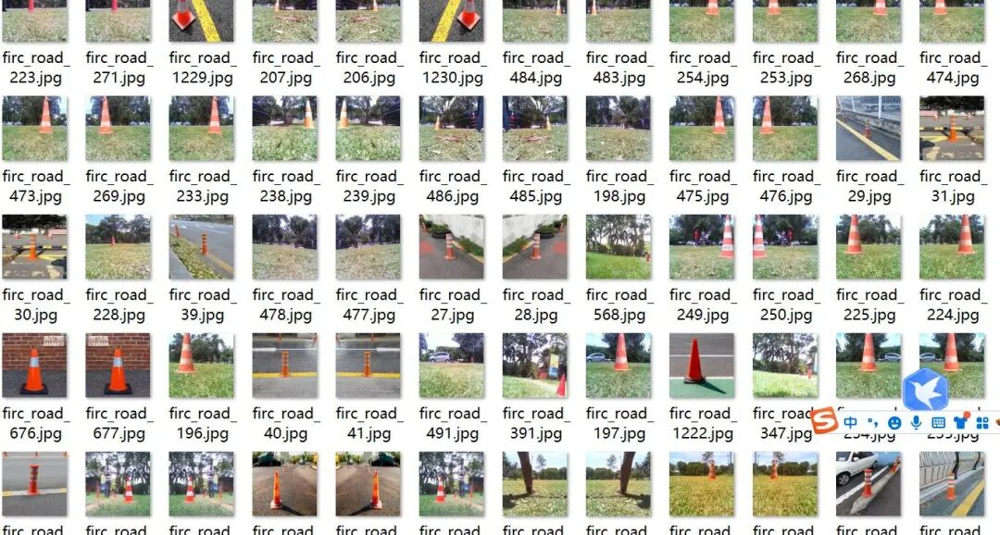
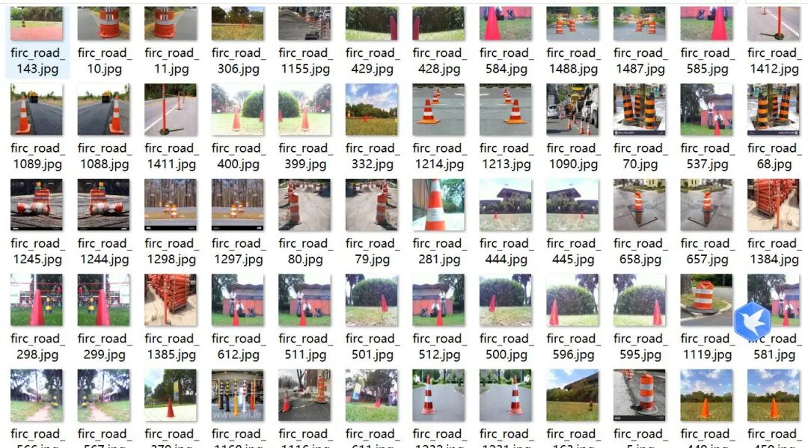
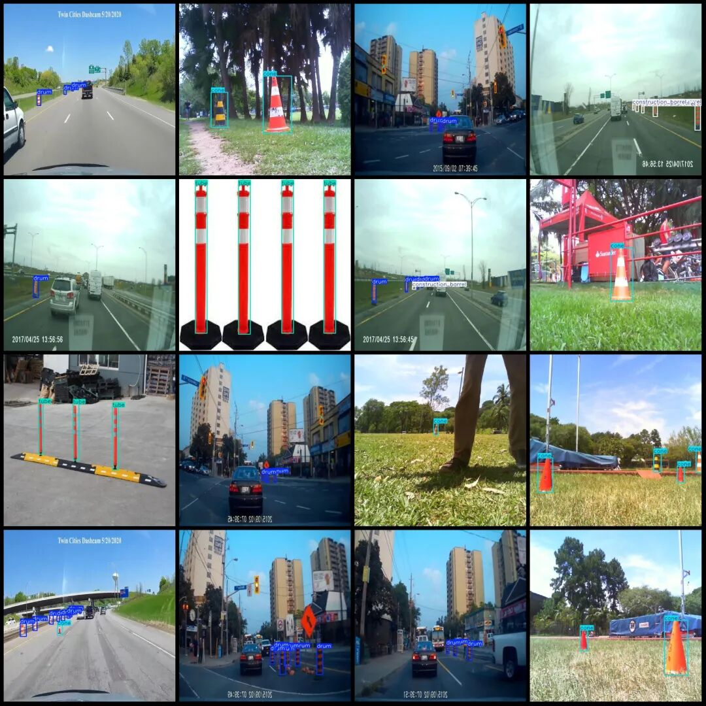

# Intelligent Traffic Road Obstacle Ice Cream Cone Separation Pillar, Traffic Barrel, and Warning Pole Identification and Detection Dataset VOC+YOLO format with 1911 images in 6 categories

Please note that about half of the dataset consists of augmented images, primarily flipped.

Dataset format: Pascal VOC format + YOLO format (txt file without split path, only containing jpg images and corresponding VOC format xml files and yolo format txt files)

Number of images (number of jpg files): 1911

Number of annotations (number of xml files): 1911

Number of annotations (number of txt files): 1911

Label count: 6

Label category names (note that the order of yolo format categories does not correspond to this, but is based on the classes.txt in the labels folder): ["cone", "construction_barrel", "drum", "traffic_barrels", "traffic_delinator", "tube"]

Number of boxes labeled in each category:

Cone (cone barrel) frame count = 1502

Construction barrel (construction barrel) frame count = 571

Drum (Cylinder) Frame Count = 2420

Traffic barrels (traffic barrels) Frame count = 156

Traffic_delimiter (traffic_guide_post) frame count = 398

Tube (pipe) Frame Count = 549

Total frame count: 5596

Image resolution: 640x640

Using labelImg:

Annotation rules: Draw a rectangle around the category.

Important Notice: No

Special : This dataset does not guarantee the accuracy of the trained models or weight files.

Image Preview:

Annotation example:

## Payment

Here is a pay link on Stripe ( https://buy.stripe.com/3cs8yP7sY87d0vu9AB ). Please contact me lonlonago@foxmail.com after funding $89, and I will send you a complete data files , thank you!

